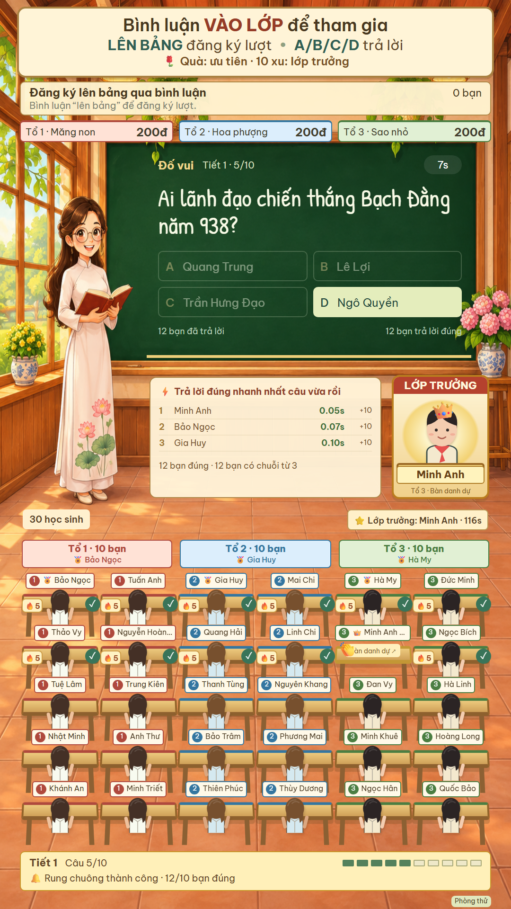
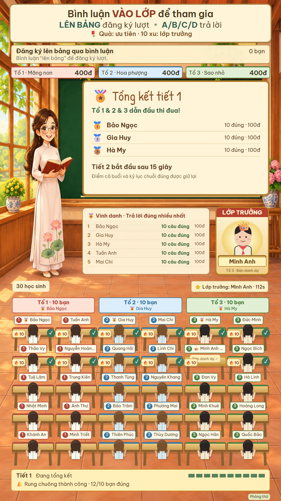

# Lớp học làng · TikTok LIVE

Game lớp học khung dọc 9:16, người xem tham gia bằng bình luận và quà tặng TikTok LIVE. Có phòng giả lập để kiểm tra trước khi phát.

## Chức năng

- Bình luận `vào lớp` để điểm danh, tự chia 3 tổ và hiện nhân vật tại ghế.
- Trả lời A/B/C/D hoặc nội dung đáp án; chốt mới công bố kết quả, đúng +10 điểm.
- Kho 120 câu hỏi, xáo trộn lựa chọn và lưu lịch sử chống lặp qua các lần khởi động.
- Mỗi tiết 10 câu, tổng kết top 3 và tổ dẫn đầu, tự sang tiết mới sau 15 giây.
- Tổ trưởng theo thành tích, chuỗi đúng, bảng người trả lời nhanh và rung chuông tập thể.
- Quà cho lượt ưu tiên lên bảng; đủ mốc được làm lớp trưởng 2 phút, ngồi bàn danh dự có vương miện. Quà không cộng điểm học tập.
- Bình luận `vỗ tay` để cổ vũ, `thành tích` để nghe điểm cá nhân.
- Giọng đọc tiếng Việt tự đọc câu hỏi, kết quả và sự kiện.

## Chạy trên PC

Cần **Node.js 22.12+**. Giọng đọc hiện dùng **Windows Speech qua PowerShell 7**, cần cài giọng tiếng Việt (máy phát triển dùng Microsoft An). Có thể đặt biến `CLASSROOM_POWERSHELL` đến file `pwsh.exe`.

```sh
npm ci
npm start
```

- Điều khiển và giả lập: <http://localhost:3000>
- Nguồn game sạch: <http://localhost:3000/?obs=1>
- Đặt nguồn OBS/LIVE Studio ở **1080 × 1920**, không quay cả thanh địa chỉ trình duyệt.

Trên Windows có thể mở `start-classroom.cmd`. `open-game-window.cmd` mở cửa sổ game riêng bằng Edge.

## Thử trước khi LIVE

Mở `start-preview.cmd`, truy cập <http://localhost:3002>. Phòng này chỉ nhận comment/quà giả lập, có dữ liệu và lịch sử câu hỏi riêng, không kết nối TikTok. Có thể thêm 8 học sinh và thử từng hoạt động qua bảng điều khiển.

| Trong tiết | Tổng kết tiết |
| --- | --- |
|  |  |

Ảnh minh họa dùng học sinh và sự kiện giả lập.

```sh
npm test
```

28 kiểm tra logic/lịch sử. Đã kiểm tra trình duyệt cục bộ với 30 học sinh, trọn một tiết, các danh hiệu, WAV giọng đọc và bố cục 390 px / 1080 px. Xem [TESTING.md](TESTING.md) về bước kiểm tra đường phát hình và tiếng thực tế.

## Kết nối và triển khai

Chạy LIVE trên TikTok rồi nhập username đang LIVE trong bảng điều khiển. Dự án dùng `tiktok-live-connector`, một thư viện không chính thức. Kết nối TikTok trong phiên dài và quà thật vẫn cần kiểm chứng trên tài khoản phát.

**Đây là bản chạy trên PC, chưa phải bản đã tương thích hoàn chỉnh với Render/Vercel.** Đưa lên cloud cần thay giọng đọc Windows, thêm xác thực điều khiển từ xa, chỉnh HTTPS/WebSocket và lưu lịch sử câu hỏi ngoài ổ đĩa tạm. Chưa có cấu hình deploy cloud trong bản này.

Dữ liệu cá nhân, browser profile và âm thanh sinh ra nằm trong `data/`, không đưa lên Git. Điểm và học sinh giữ trong RAM của server, mất khi khởi động lại server.

## Tài liệu và nguồn

- [CLASSROOM.md](CLASSROOM.md): luật chơi, lệnh bình luận và cấu trúc mã.
- [TESTING.md](TESTING.md): phạm vi đã test và giới hạn hiện tại.
- [SECURITY.md](SECURITY.md): phạm vi sử dụng trên PC.

Phần lớp học phát triển từ một dự án game chùa; mã và tài nguyên cũ vẫn được giữ để tham khảo. Tài liệu gốc ở [docs/legacy-temple-readme.md](docs/legacy-temple-readme.md), ghi nhận nguồn 3D ở [public/assets/models/README.md](public/assets/models/README.md). Công khai repository không thay đổi quyền của tài nguyên bên thứ ba.
